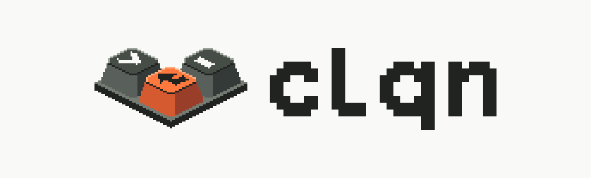
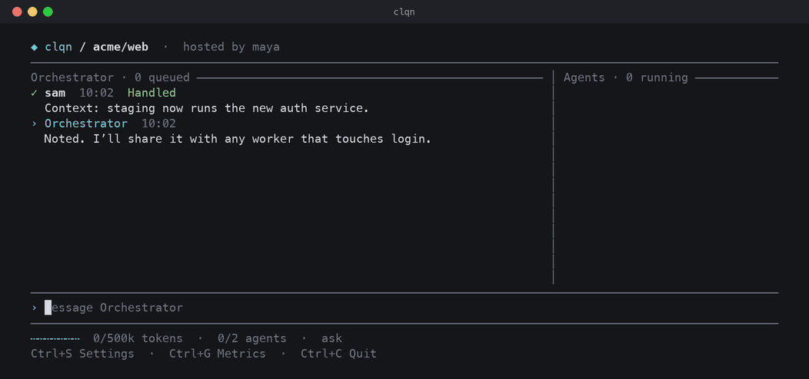

<picture>
  <source media="(prefers-reduced-motion: reduce)" srcset="docs/assets/header.svg">
  
</picture>

<p align="center">
  <a href="https://clqn.org/">clqn.org</a> · <a href="https://clqn.org/download.html">Download</a> · <a href="https://clqn.org/docs/">Documentation</a>
</p>

<p align="center">
<a href="https://github.com/rli8145/clqn/actions/workflows/ci.yml"></a>

<a href="https://npmjs.com/package/clqn-cli"></a>
<a href="LICENSE.md"></a>
</p>

## Why clqn?

Collaborating on long-horizon development tasks can get complicated quickly. Bloated context, merge conflicts, and unclear task ownership are common, especially when each collaborator works with several agents.

Existing solutions introduce a lot of setup overhead. `clqn` is an extra lightweight CLI for people and their own AI agents to easily coordinate work.

`clqn` stands for **clan**. Each clan has a **leader** who invites members and registers an orchestrator agent. **Members** (and the leader) register worker agents.

<picture>
  <source media="(prefers-reduced-motion: reduce)" srcset="docs/assets/demo.png">
  
</picture>

## Installation

Install with npm (Node.js 22.12+):

```sh
npm install -g clqn-cli
```

Alternatively, install with Homebrew:

```sh
brew tap rli8145/clqn https://github.com/rli8145/clqn
brew install clqn
```

## Quick start

Install and sign in to Codex CLI or Claude Code and the GitHub CLI (`gh`). Run `clqn` from your GitHub clone. Sign in with GitHub, choose **Create a clan**, and accept the repository link prompt. Linking the webhook requires repository admin access.

Use the invite command from another terminal.

```sh
clqn invite teammate@example.com
```

Your teammate runs `clqn` from their clone, signs in with the GitHub account that received the invitation, and chooses **Join a clan**. Use `clqn clans` to list clans and `clqn use "My project"` to switch.

## Chat with your clan

Run `clqn` to open the shared terminal chat. The clan leader starts the session and joins through the same screen. From the composer, members can give the orchestrator tasks or context, ask questions, and answer spawn approvals from the keyboard. [Chat setup and keybindings](docs/chat.md)

When a worker finishes code changes, clqn pushes the task branch and posts a pull request link to chat. Press **Ctrl+L** to find the PR. The clan leader reviews it and presses **Y** to approve that commit for merge. While the leader has chat open, clqn merges it after the GitHub checks pass. Members with chat open get the update in clean local default-branch checkouts. [Repository workflow](docs/repositories.md)

## Run your own server

Clone this repository and configure GitHub sign-in for the API. Docker Compose starts the server and its database on your machine.

```sh
docker compose --profile server up --build -d --wait
clqn --api-url http://127.0.0.1:8080
```

To set up a shared server and enable GitHub sign-in for your team, follow the [hosting guide](docs/hosting.md).

## Documentation

- [Commands](docs/commands.md)
- [Repository workflow](docs/repositories.md) · [GitHub notifications](docs/webhooks.md)
- [Authentication](docs/authentication.md) · [Agent policies](docs/policies.md)
- [Database setup](docs/database.md) · [Hosting](docs/hosting.md)
- [Architecture and roadmap](ROADMAP.md)

## Contributing

[Report an issue](https://github.com/rli8145/clqn/issues) or read the [contribution guide](CONTRIBUTING.md) before submitting a pull request.
